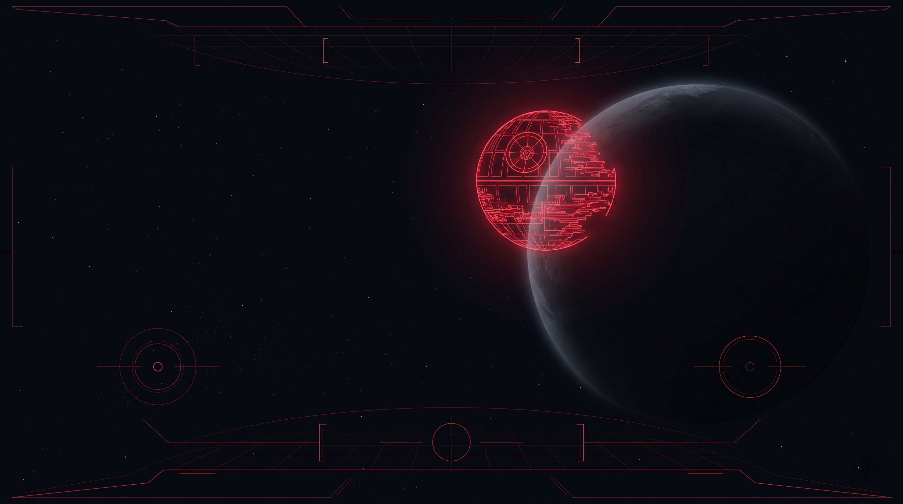

<!-- SLIDE BANNER -->

  
    
  

<!-- SOCIAL DOCK -->

  
  
  

<!-- CUSTOM ORBITAL TECH GRID -->

  

  

<!-- 2-COLUMN FEATURED REPOS + ART -->
<table>
  <tr>
    <td width="55%" valign="middle" style="border: none;">
      <h3 style="margin-top: 0;">🛰️ ACTIVE SECTOR PROJECTS</h3>
      <ul style="padding-left: 20px; line-height: 1.6;">
        <li><strong><a href="https://github.com/vihaanrawat/Relay">Relay</a></strong> — Low-latency bi-directional chat using Socket.IO, Clerk, & Docker (<a href="https://relay-2d3h.onrender.com">Live ↗</a>)</li>
        <li><strong><a href="https://github.com/vihaanrawat/travel-tales">Travel Tales</a></strong> — MERN storytelling platform powered by HttpOnly JWT auth</li>
        <li><strong><a href="https://github.com/vihaanrawat/burrow-browser-extension">Burrow</a></strong> — MV3 extension visualizing history in zoomable node SVGs</li>
      </ul>
    </td>
    <td width="45%" align="center" valign="middle" style="border: none;">
      
    </td>
  </tr>
</table>

 

  

