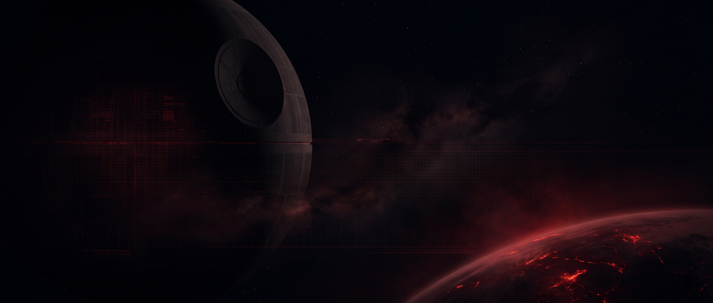

<!-- AMBIENT HERO BANNER -->

  
   
  

<!-- SOCIALS -->

  
  
  
  

<!-- SLIDING LIGHTSABER TELEMETRY -->

  

 

<!-- COMPACT FLEET + AMBIENT SCENERY -->
<table>
  <tr>
    <td width="58%" valign="middle">
      <h3>🚀 FEATURED FLEET</h3>
      <ul>
        <li><strong><a href="https://github.com/vihaanrawat/Relay">Relay</a></strong> — Real-time Socket.IO chat with Clerk auth, ImageKit & Docker (<a href="https://relay-2d3h.onrender.com">Live ↗</a>)</li>
        <li><strong><a href="https://github.com/vihaanrawat/travel-tales">Travel Tales</a></strong> — Full-stack MERN storytelling app with HttpOnly JWT auth</li>
        <li><strong><a href="https://github.com/vihaanrawat/burrow-browser-extension">Burrow</a></strong> — Manifest V3 Chrome extension mapping history into an interactive SVG graph</li>
      </ul>
    </td>
    <td width="42%" align="center" valign="middle">
      
    </td>
  </tr>
</table>

<!-- COMPACT ARSENAL -->

  
  
  
  
  
  
  
  
  

<!-- MINIMAL TELEMETRY ROW -->

  
  

